# Microsoft Sentinel SIEM Lab: Detecting Account Activity on a Domain Controller

A home lab where I connected a Windows Server domain controller to Microsoft Sentinel (a cloud SIEM), wrote three detection rules in KQL, triggered each one on purpose, and handled the incidents the way a SOC analyst would.

This builds on my [Active Directory lab](https://github.com/RushishwarM/active-directory-lab). The domain controller (`DC01`) and the PowerShell scripts from that lab are what generate the activity here.

## What I built

- Connected `DC01` (a Windows Server 2022 VM running in VMware, not in Azure) to Azure with **Azure Arc**
- Installed the **Azure Monitor Agent** on it as an Arc extension
- Created a **data collection rule** that sends Windows security events to a **Log Analytics workspace** with Microsoft Sentinel turned on
- Wrote **3 scheduled analytics rules** in KQL: brute-force logons, new account created, account disabled
- Mapped **Account** and **Host** entities on each rule so incidents show who and where
- Triggered each rule on purpose from DC01, then triaged the incidents (assign owner, comment, classify, close)
- Found and fixed two problems in my own rules (duplicate incidents, missing entities). See "Problems I ran into".

## How the data flows

```
DC01 (Windows Server, VMware)
  -> Azure Arc agent (lets Azure see the machine)
  -> Azure Monitor Agent (collects the logs)
  -> Data collection rule "dcr-dc01-security" (Common security events)
  -> Log Analytics workspace "law-sentinel-lab" (SecurityEvent table)
  -> Microsoft Sentinel analytics rules (KQL)
  -> Incidents
```

## Lab setup

| Item | Detail |
|---|---|
| Domain controller | `DC01`, Windows Server 2022, domain `lab.local` (from my AD lab) |
| Cloud | Azure free account, resource group `rg-sentinel-lab`, Canada Central |
| Workspace | Log Analytics workspace `law-sentinel-lab` with Microsoft Sentinel (31-day free trial) |
| Collection | Azure Arc + Azure Monitor Agent, data collection rule `dcr-dc01-security`, "Common" event set |
| Cost control | $5 monthly budget alert, free trial (10 GB/day included), resource group deleted when I finished |

## Step 1: Connect DC01 to Azure

DC01 is not an Azure VM, so Azure Monitor can't reach it directly. I used Azure Arc to onboard it:

1. In Azure Arc, I generated the onboarding script for a single Windows server (Canada Central, public endpoint).
2. I ran it in an admin PowerShell window on DC01. It installed the Arc agent and asked me to sign in with a device code.
3. The output ended with "Connected machine to Azure".

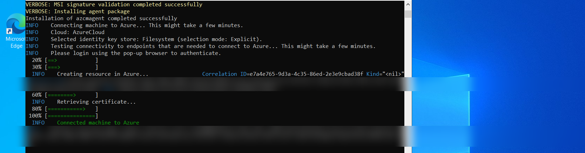

## Step 2: Collect security events

In Sentinel I installed the **Windows Security Events** solution from the Content hub and opened the **Windows Security Events via AMA** connector. I created a data collection rule (`dcr-dc01-security`), picked DC01 as the resource, and chose the **Common** event set.

The Azure Monitor Agent was then installed on DC01 as an Arc extension.

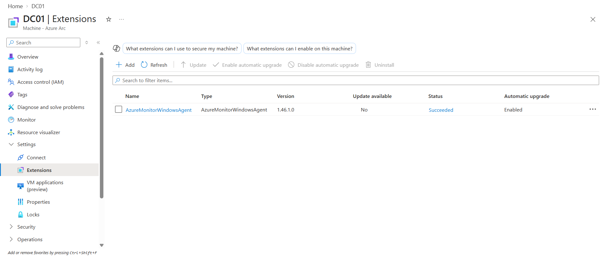
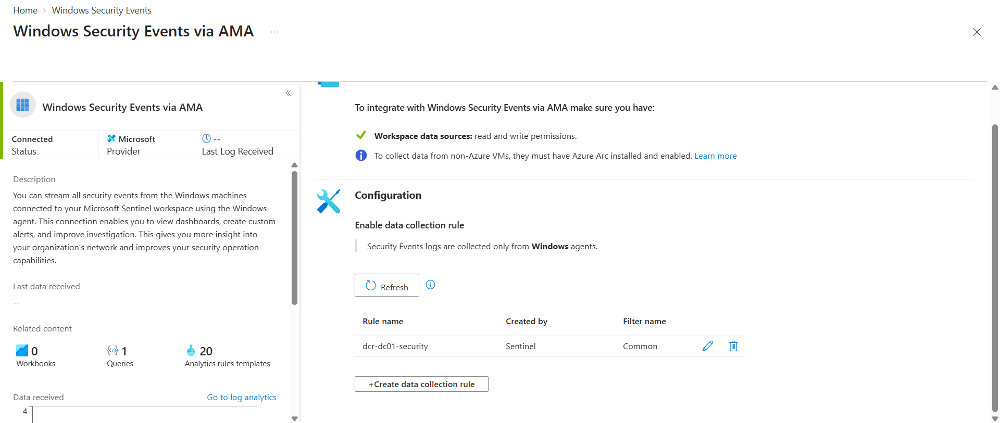

To check that data was really arriving, I ran a query in Logs (`kql/01-verify-ingestion.kql`). It showed logons (4624), special-privilege logons (4672), logoffs (4634) and more.

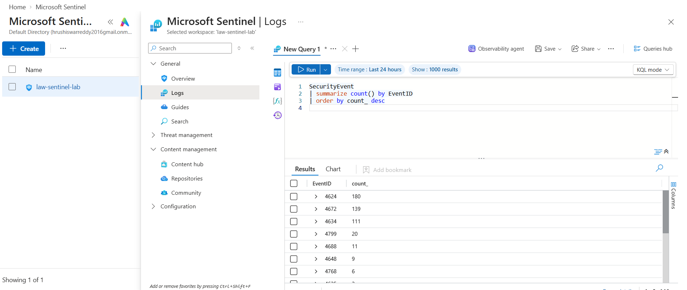

## Step 3: Detection rules

I wrote three scheduled query rules. The KQL for each is in the `kql/` folder.

| Rule | Event ID | Severity | MITRE tactic | What it catches |
|---|---|---|---|---|
| Brute force - repeated failed logons | 4625 | Medium | Credential Access | 5 or more failed logons for the same account on the same host |
| New user account created | 4720 | Low | Persistence | Any new Active Directory account |
| User account disabled (offboarding) | 4725 | Informational | Impact | An account being disabled, like during offboarding |

All three run every 5 minutes. Each one has Account and Host entity mapping.

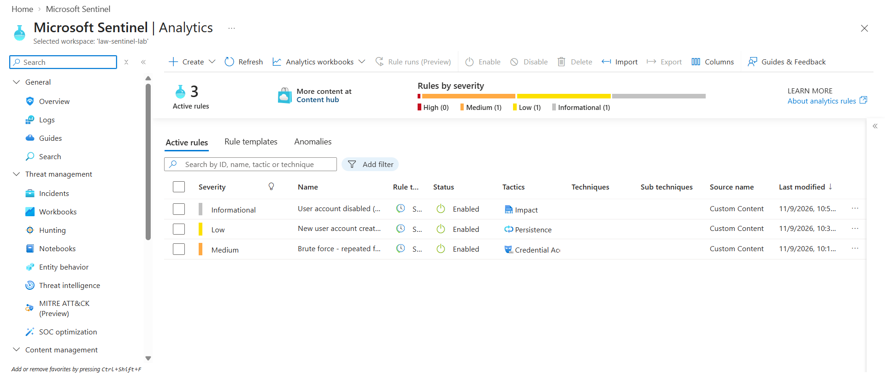
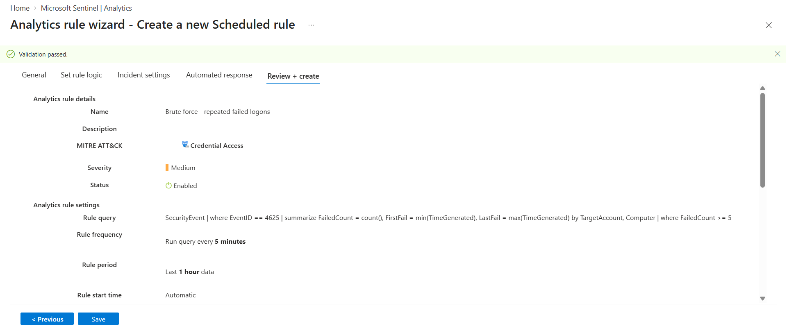

## Step 4: Trigger them on purpose

A detection that has never fired is not proven. I generated the activity myself on DC01:

- **Failed logons:** seven bad logins against a user that does not exist
  ```
  1..7 | ForEach-Object { net use \\DC01\IPC$ /user:LAB\fakeuser WrongPass1 2>$null }
  ```
- **New account:** created a test user with `New-ADUser`
- **Account disabled:** disabled the test accounts with my own `Disable-LabUser.ps1` offboarding script from the AD lab

The failed logons showed up in the logs within seconds of each other, which is exactly what password guessing looks like.

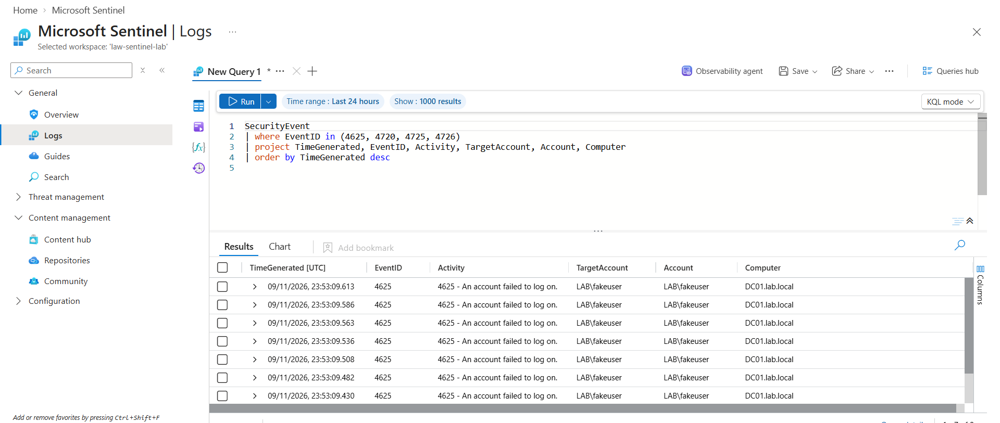

## Step 5: Handling the incidents

For each incident I did the same steps a SOC analyst would:

1. Opened the incident and checked the **Entities** tab for the account and the host
2. Assigned myself as owner and set the status to Active
3. Added a comment explaining what happened
4. Closed it with a classification and a reason

Brute force incident, with the account and host shown:

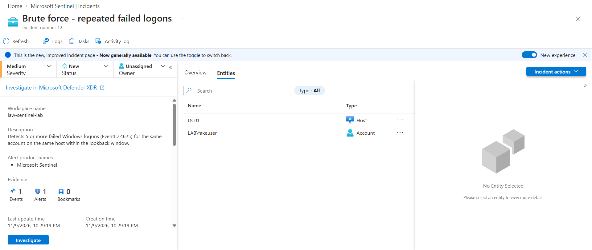

New account and disabled account incidents (both closed):

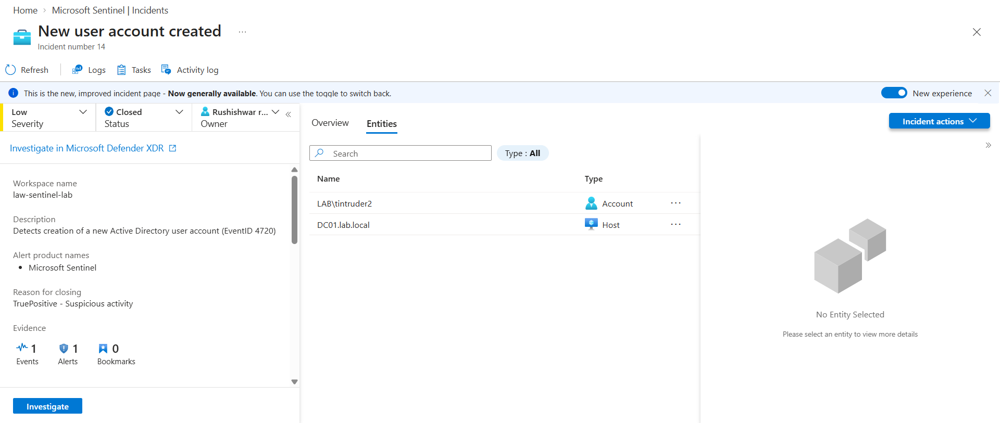
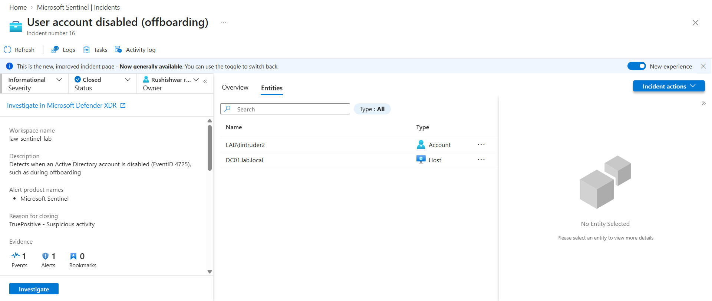

Sentinel has a built-in incident workflow, so I used that. I did not connect an external ticketing tool.

## Problems I ran into

**1. No data for a while after setup.** The Azure Monitor Agent extension showed "Creating" in the portal for a long time, and my queries returned 0 results. A service-name check on DC01 found nothing, so I looked at the extension log folder on the server instead. It showed the agent running and sending heartbeats every 30 seconds with no errors. Some time later the data appeared. The lesson: check the agent's own logs and processes, not just the portal status.

**2. Test events were created too early.** The agent only collects events that happen after it starts, and the rules only look back a short time. My first test account was created before the lookback window, so the "new user" rule never saw it. I created a fresh account after the rule existed.

**3. Duplicate incidents (alert fatigue).** My first brute-force rule looked back 1 hour but ran every 5 minutes, so it kept re-detecting the same attack. I ended up with 11 open brute-force incidents from two test runs.

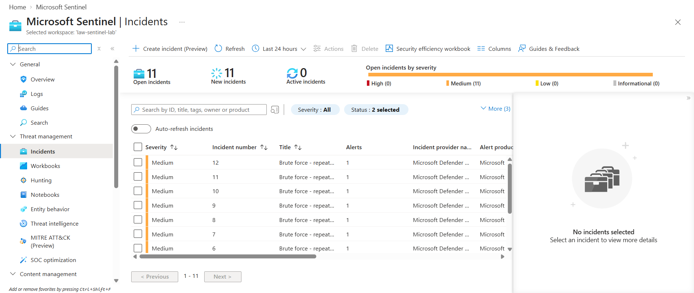

I shortened the lookback to 10 minutes. The 10-minute rules can still re-detect the same event across overlapping runs (the new-account rule fired twice, about 5 minutes apart), because two 5-minute runs overlap a 10-minute window. A better fix, which I have not applied yet, is to make the lookback match the run frequency, or to use alert grouping or suppression.

**4. Incidents showed "No entities found".** I had not told the rule which fields were the account and the host, so the incident could not show who or where. I added entity mapping (Account and Host) and re-ran the test. The new incidents list both.

**5. "Internal server error" when saving the edited rule.** It was an Azure-side error. I retried and the save went through.

## Limits

- One domain controller and one simulated attacker, on a small lab network. Real environments have far more noise.
- The rules are simple thresholds. They would need tuning against real baseline activity.
- No automation or playbooks, and no external ticketing tool.
- Duplicate incidents are reduced by the shorter lookback but not fully solved (see problem 3).

## Skills I practiced

Microsoft Sentinel, Azure Monitor Agent, Azure Arc, Log Analytics, KQL, scheduled analytics rules, entity mapping, Windows security event IDs (4624, 4625, 4720, 4725), incident triage and closure, MITRE ATT&CK tactic mapping, detection tuning, Azure cost control (budget alert, free trial, resource group clean-up).

## Planned next

- Make rule lookback match the run frequency and add alert grouping to remove the remaining duplicates
- Join a Windows 11 client to the domain and collect its logs too
- Add a rule for logons outside normal hours
